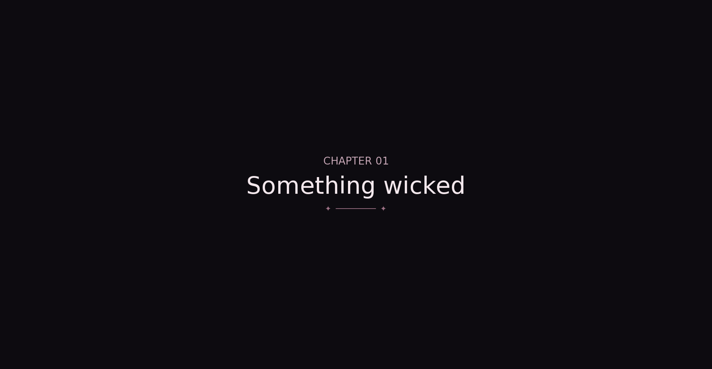
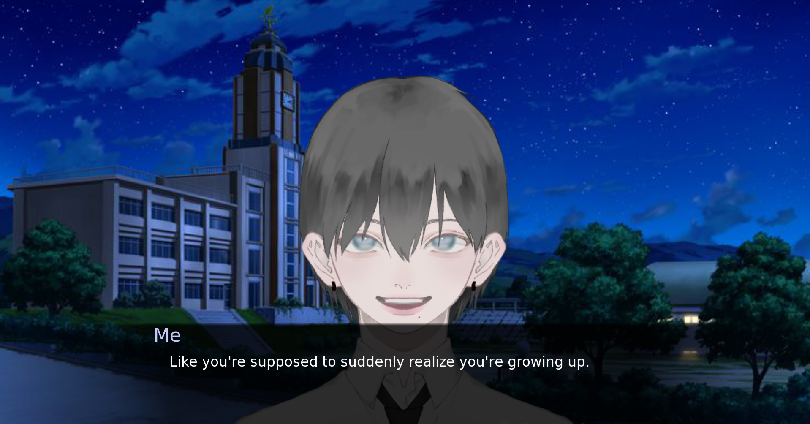

## A Familiar Face

Demo: https://khanaaaaaa.itch.io/a-familiar-face

# What It Is

A short visual name about two student council presidents setting up a Halloween haunted house, who discover a gravestone with a carved message tied to a girl who disappeared three years ago.

# Why I Made It

I LOVE DOOMED FRIENDSHIPS. Honestly forgot what I intended with the plot so the ending is pretty rushed but still very good game 10/10.

# How I Made It

Tech Stack:

- Renpy

As you can probably tell, I love to think about stories and start a RenPy visual novel. And lowk I was planning to make this a tragic friendship story (like Gojo and Geto), maybe will add more to the plot in the near future.

# What I Learnt And What I Struggled With

The Phone Texting thing made me shed a few tears lowk, I learnt to finish my RENPY stories T-T Also I really need to practice NVL. The characters were two girls at first but had guy sprites so decided to change the genders. Regardless, was fun reading back on my writing (cringing).

# Screenshots

